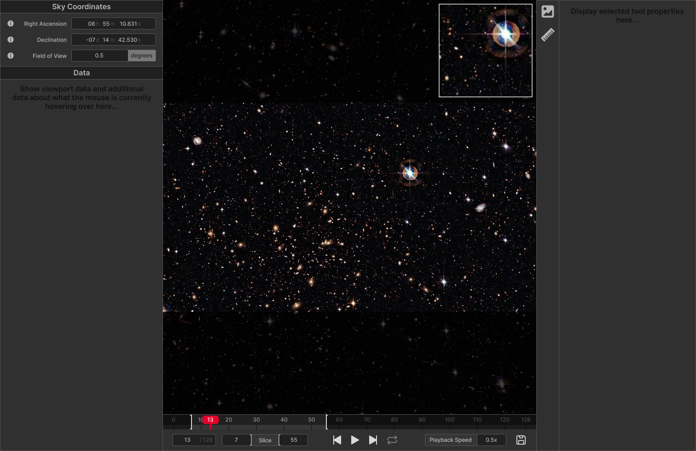

# Nasa Space Apps - Planet X and SPHEREx Challenge

https://www.spaceappschallenge.org/2026/challenges/planet-x-and-spherex/?tab=details

## Tech Stack:
 
React + Typescript + Vite \
Tailwind CSS \
WebGL2 \
FastAPI + Python 3.15 

## Plan

Mockup Design with Figma



### Features
  - Field of view slider
  - coordinate input
  - timeline
  - zoomed in view
  - ruler for measuring distance between objects

### Planned Features not shown in mockup
  - option to select images that used different infrared bands to capture it
  - include coordinates in the url so it can be embedded in other websites or projects
  - add or subtract images to help identify changes

## Tasks:
 
  - Develop Prototype GUI using React + Typescript + Vite and style with Tailwind CSS
    - Right Ascension, Declination, and FOV input panel
    - Viewport
      - Rendered image
      - Gyroscope showing viewing angle based on Right Ascension and Declination
      - Zoomed view box
      - Letterboxing (Black bars seen in movies)
    - Playback control to view/save rendered images of astronomical data visible in the viewport over time
  - Develop FastAPI backend to fetch and process NASA astronomical data for rendering
    - Analyze astronomical data and define API response format
    - Optimize data fetching preferably on separate thread to keep UI running smooth
    - Use FOV to optimize size of data fetches (i.e., small FOV doesn't need to display as much data, so don't overfetch)
  - Develop Rendering API using WebGL2 for various celestial objects
    - Will define subtasks based on released resources when event opens...

# React + TypeScript + Vite

This template provides a minimal setup to get React working in Vite with HMR and some Oxlint rules.

Currently, two official plugins are available:

- [@vitejs/plugin-react](https://github.com/vitejs/vite-plugin-react/blob/main/packages/plugin-react) uses [Oxc](https://oxc.rs)
- [@vitejs/plugin-react-swc](https://github.com/vitejs/vite-plugin-react/blob/main/packages/plugin-react-swc) uses [SWC](https://swc.rs/)

## React Compiler

The React Compiler is not enabled on this template because of its impact on dev & build performances. To add it, see [this documentation](https://react.dev/learn/react-compiler/installation).

## Expanding the Oxlint configuration

If you are developing a production application, we recommend enabling type-aware lint rules by installing `oxlint-tsgolint` and editing `.oxlintrc.json`:

```json
{
  "$schema": "./node_modules/oxlint/configuration_schema.json",
  "plugins": ["react", "typescript", "oxc"],
  "options": {
    "typeAware": true
  },
  "rules": {
    "react/rules-of-hooks": "error",
    "react/only-export-components": ["warn", { "allowConstantExport": true }]
  }
}
```

See the [Oxlint rules documentation](https://oxc.rs/docs/guide/usage/linter/rules) for the full list of rules and categories.
